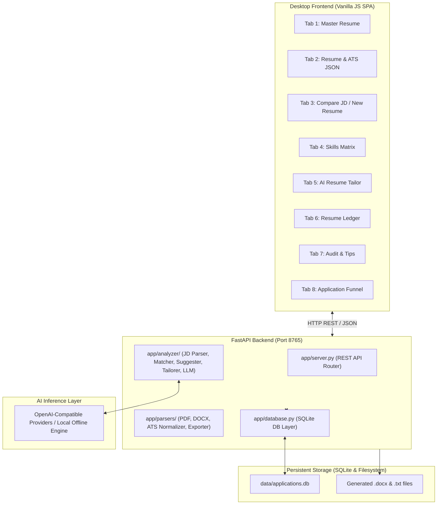
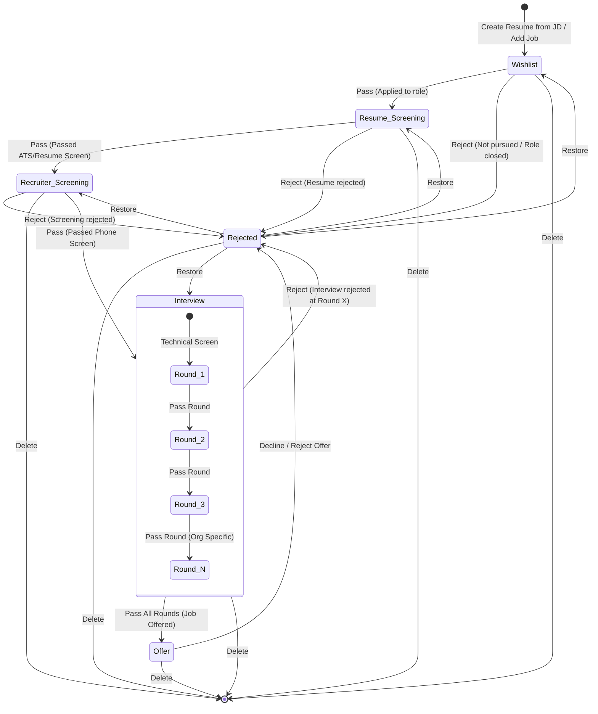

# ATS Resume Tracker & Career Suite - Complete System Architecture

This document serves as the authoritative architectural specification and engineering guide for the **ATS Resume Tracker & Career Suite**. It is specifically structured so that any engineer or AI assistant (such as Anthropic Claude or Google DeepMind Antigravity) can understand the full system, diagnose issues, trace data flow, and fix or extend the codebase safely.

---

## 1. System Overview & Core Capabilities

The ATS Resume Tracker & Career Suite is a desktop-first career intelligence platform designed to maximize ATS (Applicant Tracking System) keyword alignment, automate resume tailoring, and track application progress.



---

## 2. Directory Map & File Responsibilities

```
C:\Mine\Work\ML\Projects\Application-Tracker\
├── main.py                        # Desktop launcher (detects Edge/Chrome App mode or browser, starts Uvicorn)
├── run.bat                        # Windows 1-click execution script
├── requirements.txt               # Python package dependencies
├── README.md                      # User guide & quickstart
├── ARCHITECTURE.md                # System architectural blueprint & AI guide
│
├── app/
│   ├── __init__.py
│   ├── server.py                  # FastAPI server, route definitions, in-memory session cache
│   ├── database.py                # SQLite database schema, CRUD, migrations, funnel analytics
│   │
│   ├── parsers/                   # Document ingestion & generation
│   │   ├── __init__.py
│   │   ├── pdf_parser.py          # Extracts raw text & structure from PDF via pypdf
│   │   ├── docx_parser.py         # Extracts paragraphs & tables from DOCX via python-docx
│   │   ├── ats_normalizer.py      # Normalizes extracted text into standard ATS JSON schema & hygiene score
│   │   └── resume_exporter.py     # Generates formatted ATS-compliant .docx & .txt files via python-docx
│   │
│   ├── analyzer/                  # Intelligence & tailoring engine
│   │   ├── __init__.py
│   │   ├── jd_parser.py           # Extracts title, company, requirements, must/nice skills from JD text
│   │   ├── matcher.py             # Computes ATS score %, keyword density, dual-column skill matrix
│   │   ├── suggester.py           # Generates tailored summary rewrites & Google XYZ bullet point optimizer
│   │   ├── tailorer.py            # 3-Tier resume tailor (Tier 1: Keyword, Tier 2: Verbs, Tier 3: XYZ Overhaul)
│   │   └── llm_client.py          # OpenAI-compatible API client with local rule-based heuristic fallback
│   │
│   └── static/                    # Desktop web UI assets
│       ├── index.html             # Single-page interface containing 8 tabs & dialog modals
│       ├── css/style.css          # Dark-mode styling, 6-column Kanban layout, typography
│       └── js/app.js              # Client state, event listeners, live preview, drag-and-drop, API callers
│
├── data/
│   └── applications.db            # Local SQLite database storing applications, master resumes, ledger, API keys
│
└── tests/                         # Automated test suite
    ├── test_stage_pipeline_flow.py# Tests Wishlist, Resume Screen, Recruiter Screen, Interview, Offer, Reject
    ├── test_jobs_found_flow.py    # Tests JD resume creation, line 1 naming, Wishlist stage, ledger logging
    ├── test_server_endpoints.py   # REST API endpoint integration tests
    ├── test_tailor_and_ledger.py  # Tests 3-tier tailoring engine & DOCX export
    ├── test_master_derivation.py  # Tests Master Resume derivation, syncing & merging
    ├── test_pipeline.py           # End-to-end parser + matcher integration tests
    ├── test_pdf.py                # Unit test for PDF parser
    └── test_docx.py               # Unit test for DOCX parser
```

---

## 3. Database Schema (`app/database.py`)

All relational data is stored in `data/applications.db`. Database initialization and schema migration are managed automatically in `init_db()`.

### 1. `applications` Table
Tracks job opportunities across the recruitment funnel.

| Column | Type | Default | Description |
|---|---|---|---|
| `id` | `INTEGER` | `PRIMARY KEY` | Auto-incrementing identifier |
| `company` | `TEXT` | `""` | Company name (e.g. Google, Anthropic) |
| `role` | `TEXT` | `""` | Target role or Resume Name derived from Line 1 of JD |
| `location` | `TEXT` | `""` | Job location / Remote status |
| `stage` | `TEXT` | `'Wishlist'` | Pipeline stage (see Section 4) |
| `salary` | `TEXT` | `""` | Compensation range |
| `job_url` | `TEXT` | `""` | Link to job posting |
| `jd_text` | `TEXT` | `""` | Full pasted job description |
| `match_score` | `REAL` | `0.0` | Point-by-point ATS match percentage |
| `resume_filename` | `TEXT` | `""` | Associated customized resume filename |
| `date_applied` | `TEXT` | `""` | Date submitted (auto-stamped on entering Resume Screening) |
| `follow_up_date` | `TEXT` | `""` | Scheduled follow-up reminder date |
| `notes` | `TEXT` | `""` | Custom notes or rejection feedback |
| `interview_step` | `TEXT` | `""` | Current interview round (e.g. "Round 2: System Design") |
| `rejected_from_stage`| `TEXT` | `""` | Audit trail of exact stage where candidate was rejected |
| `created_at` | `TEXT` | `CURRENT_TIMESTAMP`| ISO 8601 creation timestamp |
| `updated_at` | `TEXT` | `CURRENT_TIMESTAMP`| ISO 8601 update timestamp |

### 2. `master_resumes` Table
Exhaustive career repository containing all candidate experiences, projects, and skills.

| Column | Type | Description |
|---|---|---|
| `id` | `INTEGER` | Primary key |
| `profile_name` | `TEXT` | Profile title (default: 'Master Profile') |
| `full_name` | `TEXT` | Candidate full name |
| `email`, `phone`, `location` | `TEXT` | Contact information |
| `linkedin`, `github` | `TEXT` | Professional profile URLs |
| `summary` | `TEXT` | Master career summary |
| `skills_json` | `TEXT` | Serialized JSON dictionary of categorized skills |
| `experiences_json` | `TEXT` | Serialized JSON array of work history items |
| `projects_json` | `TEXT` | Serialized JSON array of all career projects |
| `education_json` | `TEXT` | Serialized JSON array of academic credentials |
| `certifications_json`| `TEXT` | Serialized JSON array of certifications |
| `raw_text` | `TEXT` | Complete unstructured plain-text resume representation |

### 3. `resume_ledger` Table
Persistent audit log of every customized resume version generated.

| Column | Type | Description |
|---|---|---|
| `id` | `INTEGER` | Primary key |
| `resume_name` | `TEXT` | Name of tailored resume (Line 1 of JD) |
| `job_title` | `TEXT` | Target role title |
| `company` | `TEXT` | Target company |
| `tier` | `TEXT` | Tailoring Tier (Initial Base Match, Tier 1, Tier 2, Tier 3) |
| `source_type` | `TEXT` | Source used ('Current Resume' or 'Master Resume') |
| `source_name` | `TEXT` | Filename or profile identifier |
| `match_score_before` | `REAL` | ATS score before tailoring |
| `match_score_after` | `REAL` | ATS score after tailoring |
| `filename` | `TEXT` | Filename of generated DOCX file |
| `file_path` | `TEXT` | Absolute path to saved file on disk |
| `resume_text` | `TEXT` | Full plain text of the tailored resume |
| `ats_json` | `TEXT` | Serialized ATS-compliant structured JSON |
| `changes_summary` | `TEXT` | Serialized JSON array of specific edits made |
| `application_id` | `INTEGER` | Foreign key linking to `applications.id` |
| `created_at` | `TEXT` | Timestamp |

### 4. `api_providers` Table
Configured OpenAI-compatible LLM inference endpoints.

| Column | Type | Description |
|---|---|---|
| `id` | `INTEGER` | Primary key |
| `name` | `TEXT` | Display name (e.g. "Groq Llama 3.3", "OpenAI Official") |
| `base_url` | `TEXT` | Endpoint URL (e.g. `https://api.groq.com/openai/v1`) |
| `api_key` | `TEXT` | Secret API key |
| `model_name` | `TEXT` | Model identifier (e.g. `llama-3.3-70b-versatile`, `gpt-4o-mini`) |
| `is_active` | `INTEGER` | 1 if currently active provider, 0 otherwise |

---

## 4. Pipeline Funnel State Machine

The recruitment pipeline consists of 6 distinct stages:



### Stage Definitions & Card Behaviors:

1. **`Wishlist`**:
   - Entry point when a JD is pasted in Tab 3 or job manually added.
   - **`✓ Pass ➔`**: Advances to `Resume Screening` and automatically sets `date_applied` to today's date.
   - **`✕ Reject`**: Records rejection from Wishlist and moves to `Rejected`.
   - **`🗑 Delete`**: Permanently removes application.

2. **`Resume Screening`**:
   - Represents submitted application awaiting human/ATS review.
   - **`✓ Pass ➔`**: Advances to `Recruiter Screening`.
   - **`✕ Reject`**: Sets `rejected_from_stage: "Resume Screening"`, moves to `Rejected`.
   - **`🗑 Delete`**: Permanently removes application.

3. **`Recruiter Screening`**:
   - Represents recruiter / HR phone screen.
   - **`✓ Pass ➔`**: Advances to `Interview` and initializes `interview_step: "Round 1: Technical Screen"`.
   - **`✕ Reject`**: Sets `rejected_from_stage: "Recruiter Screening"`, moves to `Rejected`.
   - **`🗑 Delete`**: Permanently removes application.

4. **`Interview`**:
   - Represents active interview loop. Supports arbitrary organization-specific rounds.
   - Current step displayed on card badge: `🎯 Round: [interview_step]`.
   - **`✓ Pass Round ➔`**: Opens the Interview Progression Modal (`#interview-step-modal`) allowing user to enter the next step name or click quick presets (`Round 2: Coding`, `Round 2: System Design`, `Round 3: Hiring Manager`, `Round 4: Bar Raiser`).
   - **`🏆 Offer`**: Advances directly to `Offer` when all interview steps are completed.
   - **`✕ Reject`**: Sets `rejected_from_stage: "Interview (Round X)"`, moves to `Rejected`.
   - **`🗑 Delete`**: Permanently removes application.

5. **`Offer`**:
   - Terminal success stage displaying `🎉 Offer Extended!`.
   - **`✕ Decline`**: Allows recording a declined or rescinded offer into `Rejected`.
   - **`🗑 Delete`**: Permanently removes application.

6. **`Rejected`**:
   - Terminal rejection stage displaying audit badge: `❌ Rejected at: [rejected_from_stage]`.
   - **`↺ Restore`**: Moves application back to the stage it was rejected from.
   - **`🗑 Delete`**: Permanently removes application.

---

## 5. REST API Specifications (`app/server.py`)

### Jobs & Resume Creation Endpoints

#### `POST /api/jobs/create-resume`
Extracts Line 1 of the JD as `resume_name`, creates an application record in stage `"Wishlist"`, runs ATS matching against the Master Resume, and logs an entry in `resume_ledger`.
- **Request Body**:
  ```json
  {
    "jd_text": "Staff Machine Learning Engineer\nAnthropic / San Francisco\nRequirements:...",
    "company": "Optional Company Override",
    "location": "Optional Location",
    "salary": "$190k - $240k",
    "job_url": "https://..."
  }
  ```
- **Response (200 OK)**:
  ```json
  {
    "success": true,
    "resume_name": "Staff Machine Learning Engineer",
    "first_line_jd": "Staff Machine Learning Engineer",
    "application": { "id": 1, "company": "Anthropic", "stage": "Wishlist", ... },
    "ledger_entry": { "id": 1, "resume_name": "Staff Machine Learning Engineer", ... },
    "comparison": { "match_score": 82.5, "score_tier": "Strong Match", ... },
    "jd_parsed": { "role_title": "Staff Machine Learning Engineer", ... },
    "funnel_stats": { ... },
    "message": "Resume 'Staff Machine Learning Engineer' created, added to Wishlist funnel, and compared!"
  }
  ```

### Funnel Endpoints

#### `GET /api/funnel`
Returns all active applications and computed funnel statistics.

#### `POST /api/funnel`
Creates a manual application record.
- **Request Body**: `{ company, role, stage, match_score, location, salary, job_url, notes, interview_step }`

#### `PUT /api/funnel/{app_id}/stage`
Advances or changes an application's stage, capturing rejection audit and interview round progression.
- **Request Body**:
  ```json
  {
    "stage": "Resume Screening",
    "rejected_from_stage": "Recruiter Screening",
    "interview_step": "Round 2: System Design",
    "notes": "Optional feedback"
  }
  ```

#### `PUT /api/funnel/{app_id}/interview-step`
Directly updates or renames an application's interview round.
- **Request Body**:
  ```json
  {
    "interview_step": "Round 3: Hiring Manager"
  }
  ```

#### `DELETE /api/funnel/{app_id}`
Permanently deletes the application record from SQLite.

### AI Resume Tailoring Endpoints

#### `POST /api/resume/tailor`
Generates a customized resume targeting the parsed JD.
- **Request Body**:
  ```json
  {
    "tier": "tier1" | "tier2" | "tier3",
    "source_type": "current" | "master",
    "custom_instructions": "Highlight low latency and distributed systems",
    "jd_text": "..."
  }
  ```
- **Response**: Tailored ATS JSON, diff audit log, DOCX download link, and before/after match score gain.

#### `GET /api/resume/download/{ledger_id}/docx`
Downloads generated Microsoft Word `.docx` document.

---

## 6. Frontend Architecture (`app/static/`)

The frontend is a single-page application (SPA) built with vanilla JavaScript, modern CSS Grid, and zero build steps:

### Tabs Layout (`index.html`)
1. **`tab-master`**: Master Career Profile repository. Syncs, merges, and fills sections using LLMs without truncation.
2. **`tab-resume`**: Upload dropzone for active PDF/DOCX resumes. Displays ATS Hygiene score and raw JSON.
3. **`tab-compare`**: Paste JD with live First-Line Name derivation preview and "✨ Create New Resume & Compare" button.
4. **`tab-skills`**: Side-by-Side dual column matrix with filter badges (Exact, Partial, Missing).
5. **`tab-tailor`**: 3-Tier tailoring generator (Tier 1: Minor, Tier 2: Reframing, Tier 3: Full Google XYZ overhaul).
6. **`tab-ledger`**: Version-controlled list of all generated resumes with DOCX download and inspection modal.
7. **`tab-suggestions`**: Recommended professional summary rewrites and Google XYZ STAR bullet enhancements.
8. **`tab-funnel`**: 6-column Kanban pipeline board (`Wishlist`, `Resume Screening`, `Recruiter Screening`, `Interview`, `Offer`, `Rejected`).

### Client State Variables (`app.js`)
- `currentResumeData`: Active parsed resume data and ATS JSON schema.
- `masterResumeData`: Master career repository record.
- `currentJdData`: Parsed job description structure.
- `currentComparison`: ATS match score, keyword density, and side-by-side matrix.
- `currentFunnelApps`: List of applications loaded from `/api/funnel`.
- `resumeLedgerEntries`: List of versions from `/api/resume/ledger`.
- `activeInterviewApp`: Application currently being edited in `#interview-step-modal`.
- `activeRejectApp`: Application currently being confirmed in `#reject-modal`.

---

## 7. How to Ask Claude / AI to Fix or Extend the Code

When asking Claude or another AI assistant to modify this codebase, provide these guidelines:

1. **Refer to this document**:
   Tell the assistant to review `ARCHITECTURE.md` to see where data structures and routes are defined.
2. **Database Changes**:
   - If adding a column to `applications` or `resume_ledger`, add an `ALTER TABLE` inside `init_db()` in `app/database.py` wrapped in a `try...except` block so existing databases migrate seamlessly without errors.
   - Always update `allowed_fields` in `update_application()`.
3. **Stage Logic**:
   - Do NOT re-introduce `Jobs Found` as a separate stage or tab. `Wishlist` is Stage 1.
   - Always respect the 6 stages: `["Wishlist", "Resume Screening", "Recruiter Screening", "Interview", "Offer", "Rejected"]`.
   - When advancing from `Wishlist` to `Resume Screening`, remember to stamp `date_applied`.
4. **Testing Before Completion**:
   - Run the automated test suites using the virtual environment:
     ```powershell
     .\.venv\Scripts\python.exe tests/test_stage_pipeline_flow.py
     .\.venv\Scripts\python.exe tests/test_jobs_found_flow.py
     .\.venv\Scripts\python.exe tests/test_server_endpoints.py
     .\.venv\Scripts\python.exe tests/test_tailor_and_ledger.py
     .\.venv\Scripts\python.exe tests/test_master_derivation.py
     ```

5. **Verifying APIs**:
   - Interactive Swagger UI: `http://127.0.0.1:8765/docs`
   - ReDoc Reference UI: `http://127.0.0.1:8765/redoc`
   - OpenAPI 3.1 JSON: `http://127.0.0.1:8765/openapi.json`

