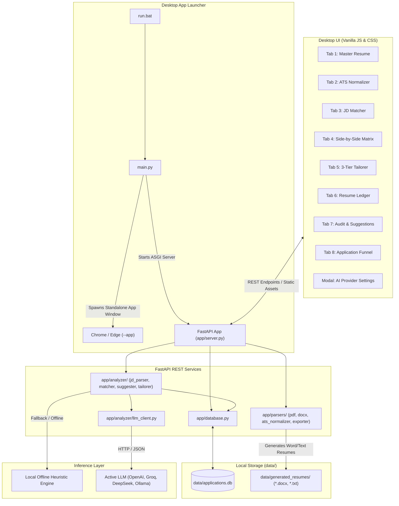

### Project Overview

The **ATS Resume Tracker & Career Suite** is a desktop application designed to streamline the technical job application cycle. It provides an automated pipeline spanning resume parsing, ATS hygiene scoring, JD requirement matching, multi-tier AI resume tailoring with DOCX/TXT document generation, a historical resume ledger, and a Kanban application funnel.

- **Frontend**: Vanilla ES6+ JavaScript, CSS3 (Dark Theme), and HTML5 single-page application served via FastAPI static mounting.
- **Backend API**: [FastAPI](file:///c:/Mine/Work/ML/Projects/Application-Tracker/app/server.py) with [Uvicorn](file:///c:/Mine/Work/ML/Projects/Application-Tracker/main.py) running on an auto-allocated local port (`8765+`).
- **Desktop Window Launcher**: [main.py](file:///c:/Mine/Work/ML/Projects/Application-Tracker/main.py) spawns Edge or Chrome in standalone window mode (`--app=http://127.0.0.1:<port>`) or defaults to the system browser.
- **Database**: Local SQLite database located at `data/applications.db`, accessed via [app/database.py](file:///c:/Mine/Work/ML/Projects/Application-Tracker/app/database.py).
- **Inference Strategy**: **Dual-Engine Architecture**. All features (matching, suggestions, 3-tier tailoring) run offline using deterministic rule-based heuristics or can be powered by any OpenAI-compatible LLM provider (OpenAI, OpenRouter, Groq, DeepSeek, local Ollama/vLLM) configured in SQLite.

---
### Architecture & System Flow Diagram

### Architecture & System Flow Diagram

---

### End-to-End User & Data Flow

#### 1. Ingestion & ATS Normalization Flow
- **User Action**: Drops a PDF, DOCX, or TXT file (or pastes text) into **Tab 1 (Master Resume)** or **Tab 2 (Resume & ATS JSON)**.
- **Backend Flow**:
  1. [`/api/resume/parse`](file:///c:/Mine/Work/ML/Projects/Application-Tracker/app/server.py#L55-L100):
     - PDF extracted via [`extract_text_from_pdf`](file:///c:/Mine/Work/ML/Projects/Application-Tracker/app/parsers/pdf_parser.py#L6-L43) (`pypdf` reading text streams, checking multi-column layouts).
     - DOCX extracted via [`extract_text_from_docx`](file:///c:/Mine/Work/ML/Projects/Application-Tracker/app/parsers/docx_parser.py#L5-L42) (`python-docx` extracting paragraphs and table cells).
  2. [`normalize_to_ats_json`](file:///c:/Mine/Work/ML/Projects/Application-Tracker/app/parsers/ats_normalizer.py#L357-L406):
     - Segments sections (Summary, Skills, Experience, Education, Projects, Certifications).
     - Extracts contact metadata (phone, email, links, location).
     - Evaluates ATS Hygiene Score (0–100) based on action verbs, quantifiable metrics (`%`, `\$`, numbers), length, and structural formatting safety.
  3. Automatically derives and initializes/syncs candidate details into the **Master Resume** in SQLite via [`sync_master_resume_from_ats`](file:///c:/Mine/Work/ML/Projects/Application-Tracker/app/database.py).

#### 2. Master Resume & Career Project Repository Flow
- **Purpose**: Acts as the candidate's single source of truth containing exhaustive past roles, technical projects with metrics, skills taxonomy, and education.
- **Backend Flow**:
  - Saved in SQLite table `master_resumes` via [`get_master_resume`](file:///c:/Mine/Work/ML/Projects/Application-Tracker/app/database.py#L574-L610) and [`save_master_resume`](file:///c:/Mine/Work/ML/Projects/Application-Tracker/app/database.py#L611-L650).
  - Can be enriched using [`clean_and_extract_master_resume_with_llm`](file:///c:/Mine/Work/ML/Projects/Application-Tracker/app/analyzer/llm_client.py#L128-L239) to parse complex raw resumes without string truncation or loss of metrics.

#### 3. Job Description Parsing & Match Scoring Flow
- **User Action**: Pastes a job description in **Tab 3 (Compare to JD)** and clicks **Analyze Match**.
- **Backend Flow**:
  1. [`parse_job_description`](file:///c:/Mine/Work/ML/Projects/Application-Tracker/app/analyzer/jd_parser.py#L16-L136):
     - Detects role title, company, experience years, seniority level, and degree requirements.
     - Classifies skills into **Must-Have** vs. **Nice-to-Have** based on JD section headers.
     - Parses detailed requirement phrases (e.g. *"Knowledge of Classification, Q&A networks using BERT"*).
  2. [`compare_resume_to_jd_async`](file:///c:/Mine/Work/ML/Projects/Application-Tracker/app/analyzer/matcher.py#L234-L349):
     - Checks active LLM provider; if present, sends full JD & Resume for deep requirement audit.
     - If offline, [`compare_resume_to_jd`](file:///c:/Mine/Work/ML/Projects/Application-Tracker/app/analyzer/matcher.py#L25-L232) uses skill taxonomy clusters, partial match families (e.g., SQL/Postgres, Python/PyTorch), and n-gram overlap.
     - Computes the overall Match Score formula:
       $$\text{Score} = (0.60 \times \text{MustHaves}) + (0.20 \times \text{NiceToHaves}) + (0.20 \times \text{SeniorityBonus})$$

#### 4. Side-by-Side Skills Matrix & Suggestions Flow
- **Tab 4 (Side-by-Side Skills)**:
  - Renders a dual-column matrix comparing each JD requirement with resume evidence.
  - Badges each item: `Exact Match` (✅), `Partial Match` (⚠️), or `Missing` (❌).
  - Supplies context, gap advice, and an instant **Google XYZ formula** action bullet (*"Accomplished [X] measured by [Y] by doing [Z]"*).
- **Tab 7 (Audit & Tips)**:
  - Generated by [`generate_resume_suggestions_async`](file:///c:/Mine/Work/ML/Projects/Application-Tracker/app/analyzer/suggester.py#L123-L194).
  - Generates an ATS-tailored professional summary and per-job bullet point rewrites.

#### 5. 3-Tier AI Resume Tailoring & Document Generation Flow
- **User Action**: In **Tab 5 (AI Resume Tailor)**, the user chooses source (**Master Resume** or **Current Resume**) and a tailoring tier:
  - **Tier 1: Minor Changes** (Surgical keyword injection into summary and bullets without sentence restructures).
  - **Tier 2: Reframing** (Action verb elevation, executive framing, and target competency integration).
  - **Tier 3: Major Redo** (Full overhaul with Google XYZ rewrites and dynamic selection of the top 3 matching projects from the Master repository).
- **Backend Flow**:
  1. [`tailor_resume_async`](file:///c:/Mine/Work/ML/Projects/Application-Tracker/app/analyzer/tailorer.py#L252-L467) prompts the active LLM or executes [`build_heuristic_tailoring`](file:///c:/Mine/Work/ML/Projects/Application-Tracker/app/analyzer/tailorer.py#L62-L250).
  2. [`generate_resume_docx`](file:///c:/Mine/Work/ML/Projects/Application-Tracker/app/parsers/resume_exporter.py#L42-L314) renders a formatted, ATS-compliant Word `.docx` file into `data/generated_resumes/` with styling (0.75" margins, Calibri, Navy headings, bullet points) and writes a corresponding `.txt` file.
  3. Re-evaluates the newly tailored resume against the JD to calculate the **New Match Score** and **Score Gain**.
  4. Saves the entire tailored output and diff report into the `resume_ledger` SQLite table via [`add_ledger_entry`](file:///c:/Mine/Work/ML/Projects/Application-Tracker/app/database.py).

#### 6. Resume Ledger & Application Funnel Flow
- **Tab 6 (Resume Ledger)**:
  - Displays all tailored resume versions with timestamps, source profile, before/after match scores, diff changelog, and instant DOCX/TXT download links.
  - Allows 1-click linking of any tailored resume to a tracked application.
- **Tab 8 (Application Funnel)**:
  - Kanban board managing 6 core stages: `Wishlist` ➔ `Applied` ➔ `Screening` ➔ `Interviewing` ➔ `Offer` ➔ `Rejected`.
  - Calculates real-time conversion rates (Screening Rate, Interview Rate, Offer Rate).
  - One-click transfer from Tab 3 ("Add to Funnel") automatically pulls Company, Role, Salary, and Match Score directly into the funnel.

---

### Key File Map

| Component | Key Files | Responsibility |
|---|---|---|
| **Entrypoint & Server** | [main.py](file:///c:/Mine/Work/ML/Projects/Application-Tracker/main.py), [app/server.py](file:///c:/Mine/Work/ML/Projects/Application-Tracker/app/server.py) | Desktop window spawning, port discovery, FastAPI route handlers |
| **Database & ORM** | [app/database.py](file:///c:/Mine/Work/ML/Projects/Application-Tracker/app/database.py) | SQLite tables (`applications`, `master_resumes`, `resume_ledger`, `api_providers`) |
| **Document Parsers & Exporters** | [pdf_parser.py](file:///c:/Mine/Work/ML/Projects/Application-Tracker/app/parsers/pdf_parser.py), [docx_parser.py](file:///c:/Mine/Work/ML/Projects/Application-Tracker/app/parsers/docx_parser.py), [ats_normalizer.py](file:///c:/Mine/Work/ML/Projects/Application-Tracker/app/parsers/ats_normalizer.py), [resume_exporter.py](file:///c:/Mine/Work/ML/Projects/Application-Tracker/app/parsers/resume_exporter.py) | Ingestion of PDF/DOCX, ATS JSON normalization, hygiene scoring, DOCX generation |
| **Analysis & AI Engines** | [jd_parser.py](file:///c:/Mine/Work/ML/Projects/Application-Tracker/app/analyzer/jd_parser.py), [matcher.py](file:///c:/Mine/Work/ML/Projects/Application-Tracker/app/analyzer/matcher.py), [suggester.py](file:///c:/Mine/Work/ML/Projects/Application-Tracker/app/analyzer/suggester.py), [tailorer.py](file:///c:/Mine/Work/ML/Projects/Application-Tracker/app/analyzer/tailorer.py), [llm_client.py](file:///c:/Mine/Work/ML/Projects/Application-Tracker/app/analyzer/llm_client.py) | Requirement extraction, scoring, suggestion generation, 3-tier tailoring, LLM routing |
| **Frontend Assets** | [index.html](file:///c:/Mine/Work/ML/Projects/Application-Tracker/app/static/index.html), [app.js](file:///c:/Mine/Work/ML/Projects/Application-Tracker/app/static/js/app.js), [style.css](file:///c:/Mine/Work/ML/Projects/Application-Tracker/app/static/css/style.css) | Tab switching, reactive matrix filtering, file dropzone, modal dialogs, Kanban interactions |
| **Test Suite** | [tests/](file:///c:/Mine/Work/ML/Projects/Application-Tracker/tests/) | Verification tests for pipeline, BERT requirement matching, docx/pdf parsers, tailorer & ledger |

---

### Initial Observations & Findings

1. **Missing Import in [app/server.py](file:///c:/Mine/Work/ML/Projects/Application-Tracker/app/server.py)**:
   - On lines 108, 127, 157, 261, 272, 304, and 315, `build_raw_master_text(...)` is called, but it is not imported from `app.database` on lines 9–17. Whenever an active resume is absent or a payload contains raw `master_data`, this can trigger a `NameError`.
2. **Robust Offline Capability**:
   - The system is built so that an internet connection or external LLM API key is optional. When no provider is active, deterministic heuristic algorithms handle skill parsing, scoring, bullet rewriting, and 3-tier tailoring.
3. **Verified Health**:
   - All tests in the test suite pass with the local virtual environment (`.\.venv\Scripts\python.exe`).

Let me know what you would like to work on next (e.g., fixing the missing import, enhancing tailoring, or adding new features)!